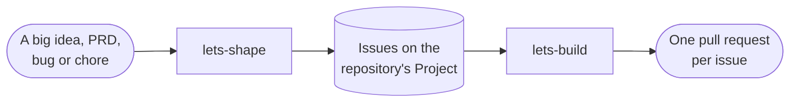

# 📐 Let's Spec

## 🧐 What is this thing?

Let's Spec (`lets-spec`) is a planning workflow for AI coding agents, built
on [OpenSpec](https://github.com/Fission-AI/OpenSpec). It gives each of
your projects the same agent skills, the same OpenSpec schema and the same
working rules. You install it with a Nix flake, or with
[mise](https://mise.jdx.dev) from a release on GitHub.

You talk to it through two skills:

- **`lets-shape`** shapes a big idea, or one bug, chore or story, into
  issues on the repository's GitHub Project.
- **`lets-build`** takes the next one from that backlog and moves it
  through planning, building, review and archive.

A third skill, **`lets-setup-backlog`**, creates that Project once per
repository.

It is a personal, unofficial project. It is not part of OpenSpec.

## ✨ Why

Agents write better code when they plan first, but every project ends up
with its own copy of the planning rules, and the copies drift apart. Let's
Spec keeps one copy here, and copies it into each project. It aims to:

- **Plan before code.** Every change starts with a brainstorm with you,
  and ends with an archived spec. The agent never jumps straight to code.
- **Keep work small.** A big idea is cut into thin stories, and one story
  becomes one OpenSpec change, one branch and one pull request.
- **Review with a second opinion.** In the `standard` flow, plans and code
  are reviewed by a model from a different family than the one that
  wrote them, so the reviewer does not share the author's blind spots.
- **Let parallel sessions share one backlog.** A session claims a story
  before it starts, so two sessions never build the same thing.
- **Update every project at once.** A project pins a commit or a release
  of this repo. Moving the pin updates its skills, schema and rules
  together.

## 🧩 What's inside

| Part | What it does |
|---|---|
| Entry-point skills | `lets-shape`, `lets-build` and `lets-setup-backlog`. See [The backlog](#-the-backlog). |
| Flows | An OpenSpec schema plus the skills it calls: `standard` or `minimal`. A project uses one. See [The flows](#-the-flows). |
| Flow skills | How the agent brainstorms, writes specs, tasks and ADRs, builds test-first, and reviews: `lets-brainstorm`, `lets-write-specs`, `lets-write-tasks`, `lets-write-adrs`, `lets-test-first`, `lets-review-plan` and `lets-review-code`. The schemas and the other skills call them. |
| OpenSpec skills (`openspec-*`) | Generated by the flake from the OpenSpec command-line tool (CLI) |
| Working rules | The rules every project shares, kept in a marked block of the project's `AGENTS.md` |
| `lets` | The command-line tool. `lets sync` sets a project up and keeps it up to date. `lets delegate` runs a prompt in a fresh session, for the review skills and `lets-build`. See [Fresh sessions](#-fresh-sessions). |
| Nix flake module | Puts the OpenSpec CLI, `lets` and `gh` in the project's dev shell, and runs `lets sync` each time the shell starts |
| Release tarball | `lets` and the skills for every flow, published on GitHub for each release. mise installs it. |
| Contrib resolver | `contrib/lets-delegate-resolver/`: starts fresh sessions inside T3 Code and herdr. It is personal to your machine, so no project installs it. See [The T3 Code and herdr resolver](#the-t3-code-and-herdr-resolver). |

`lets sync` copies the skills into `.agents/skills/` and the schemas into
`openspec/schemas/`. By default your project commits these copies, along
with the working rules. So every clone has the skills, even without Nix or
mise. You can choose to have git ignore the copies instead. See
[Committed or ignored skills](#committed-or-ignored-skills).

## 📦 Set it up

### Requirements

| Tool | Version | Why |
|---|---|---|
| Nix with flakes, or mise | | Installs the tools below, and runs `lets sync`. |
| GitHub repository | | The backlog is a GitHub Project linked to it. |
| GitHub CLI (`gh`) | 2.102.0 or later | The skills set Project fields by name with `gh project item-edit`, and create sub-issues and "blocked by" links. The flake supplies it. With mise, you pin it. |
| OpenSpec CLI | The version the release was generated from | The `openspec-*` skills are generated from it. The flake supplies the matching version. With mise, you pin it. See [With mise](#with-mise). |
| Node | 26 or later | `lets` runs on it. The flake supplies it. With mise, you pin it. |
| At least one of `codex`, `claude` or `agy` | any | `lets delegate` runs reviews through one of these, in a fresh session. Install one from a model family other than the one that writes your code, or the reviews are not independent. With none, the review skills run a subagent instead, and the reviews are not independent. |

### 1. Choose a flow and a skills mode

| Choice | Values | What it decides |
|---|---|---|
| `flow` | `standard` (default) or `minimal` | How each change is planned and built. See [The flows](#-the-flows). |
| `skills` | `committed` (default) or `ignored` | Whether git tracks the skills and the schemas that `lets sync` copies into the project. See [Committed or ignored skills](#committed-or-ignored-skills). |

### 2. Add Let's Spec to your project

Use Nix or mise. Both install the same `lets` command and the same skills.

#### With Nix

Add the flake input:

```nix
inputs.lets-spec.url = "github:andrewduckett/lets-spec";
```

Follow the `main` branch. Your `flake.lock` pins the exact commit.

In a flake built with [flake-parts](https://flake.parts), import the
module and use its packages and shell hook:

```nix
imports = [ inputs.lets-spec.flakeModules.default ];
perSystem = { config, pkgs, ... }: {
  letsSpec = {
    flow = "standard";
    skills = "committed";   # or "ignored"
  };
  devShells.default = pkgs.mkShell {
    packages = config.letsSpec.packages;
    shellHook = config.letsSpec.shellHook;
  };
};
```

The module sets the skills mode for `lets sync`, whether the shell hook
runs it or you do.

In a flake without flake-parts, use the package named for the flow:

```nix
devShells.default = pkgs.mkShell {
  packages = [ lets-spec.packages.${system}.standard ];
  # Skip the sync in CI, so lets sync --check sees the committed tree.
  shellHook = ''
    if [ -z "''${CI:-}" ]; then lets sync; fi
  '';
  # LETS_SPEC_SKILLS = "ignored";
};
```

Without the module, `lets sync` reads the skills mode from the
`LETS_SPEC_SKILLS` environment variable. `mkShell` sets it when you
uncomment the line above.

#### With mise

Add this to your project's `mise.toml`:

```toml
[tools]
node = "26"
gh = "2.102"
"npm:@fission-ai/openspec" = "1.13.2"   # the version in the release notes
"github:andrewduckett/lets-spec" = { version = "0.1.0", asset_pattern = "lets-spec-0.1.0.tar.gz" }

[env]
LETS_SPEC_FLOW = "standard"
# LETS_SPEC_SKILLS = "ignored"

[hooks]
enter = "lets sync"
```

The `lets-spec` version and the `asset_pattern` name the same release.
Change them together.

Pin the OpenSpec CLI to the version the release was generated from. Each
release names it in its GitHub release notes, and in the `openspec` field
of its `release.json`. The `openspec-*` skills are generated from that
version. If the CLI on your `PATH` is another version, `lets sync` warns
you and names the version to pin.

The `enter` hook runs `lets sync` when you `cd` into the project. mise
runs hooks only in a shell where `mise activate` is set up. Without it,
run `mise exec -- lets sync` yourself.

### 3. Run `lets sync`

Enter the dev shell, or `cd` into the project with mise. `lets sync`
runs. The first time, it:

- adds the working rules to `AGENTS.md`, between two markers, and creates
  `AGENTS.md` if it is missing
- creates `openspec/config.yaml`, set to your flow's schema. In the
  standard flow, it also holds the code review rule.
- links `CLAUDE.md` to `AGENTS.md`, and `.claude/skills` to
  `.agents/skills`, so Claude Code reads the same files as other agents
- copies the skills into `.agents/skills/` and the schemas into
  `openspec/schemas/`. Besides your flow's schema, `lets-minimal` is
  always copied in, for chores and small stories.
- lists anything you still need to fix

### 4. Describe your project and commit

Add your own instructions to `AGENTS.md`, outside the markers: what the
project is, its layout and how to run its checks. Agents run those checks
before they push, and branch each change off the repository's default
branch.

Then commit:

- `AGENTS.md`, `CLAUDE.md` and `.claude/skills`
- `openspec/config.yaml`
- the skills in `.agents/skills/` and the schemas in `openspec/schemas/`
- `mise.toml`, if you use mise

With the `ignored` skills mode, `lets sync` adds a block to `.gitignore`
instead, so git ignores the skills and the schemas. Commit `.gitignore`,
and do not commit the copies.

The next time `lets sync` runs, it prints nothing if all is well.

> [!NOTE]
> With the default `committed` mode, every clone has the skills. A cloud
> session or a clone without Nix or mise still reads the rules and the
> skills. The dev shell, from Nix or mise, supplies the tools the skills
> call: the OpenSpec CLI, `gh` and `lets`.

## Specs in a monorepo

Keep one set of skills and one `openspec/` directory at the repository root.
This follows [OpenSpec's monorepo recommendation](https://github.com/Fission-AI/OpenSpec/blob/main/docs/existing-projects.md#monorepos-and-work-that-spans-repos).
Group specs by application, service or feature as the project needs:

```text
.agents/skills/                        # shared skills
AGENTS.md                              # shared workflow rules
openspec/
  config.yaml                          # shared schema and project context
  specs/
    backend/checkout/spec.md
    frontend/checkout/spec.md
    shared/user-auth/spec.md
  changes/
```

A **domain** is a logical grouping of behavior specs. A **capability path**
identifies one spec relative to `openspec/specs/`, such as `user-auth` or
`backend/checkout`. Domain grouping is optional: existing flat paths such as
`openspec/specs/user-auth/spec.md` continue to work without migration or new
configuration.

Before planning, the agent lists existing capabilities and reads the affected
specs, including shared behavior the change depends on:

```sh
openspec list --specs
openspec show backend/checkout --type spec
openspec show shared/user-auth --type spec
```

Use full capability IDs from the list. `backend/checkout` and
`frontend/checkout` are different capabilities, even though their last path
segment is the same. Strict validation alone does not prove that a delta
targets an existing capability.

Domain names do not automatically map to source directories. Describe useful
mappings in the existing `openspec/config.yaml` context, for example:

```yaml
context: |
  Backend capabilities describe apps/api; frontend capabilities describe apps/web.
  Shared authentication behavior is implemented in packages/auth.
```

The agent uses this context, the request and the code to find relevant specs.
When the scope is clear, it proceeds without a separate domain-selection
prompt.

One change can update several domains. For a checkout story, put deltas at
`openspec/changes/add-checkout/specs/backend/checkout/spec.md` and
`openspec/changes/add-checkout/specs/frontend/checkout/spec.md`. Each full
capability path matches its main spec under `openspec/specs/` during
sync/archive. Read shared authentication for context, but include its delta
only if its requirements change. Skills, Git branches and pull requests stay
shared across the repository.

## 📋 The backlog

The backlog is the GitHub Project linked to your repository. Every piece
of work is an issue on that Project, and its Kind, Priority, Size and
Status are Project fields. Three skills work with it.



| You want to | Run |
|---|---|
| Split or prioritize a large idea | `lets-shape` |
| File a bug, a chore or a single story, or finish an issue that has no packet | `lets-shape` |
| Start the next story, or carry on the change on your current branch | `lets-build` |
| Set up or check this repository's backlog | `lets-setup-backlog` |

### `lets-setup-backlog`: create or check the Project

Run it once in a new repository. It looks for the open Project linked to
the repository:

- **None:** it creates one named after the repository, adds the Kind,
  Priority and Size fields, and links it.
- **One:** it checks the Project against
  [the Project fields](#the-project-fields), and names each gap and its
  fix. It runs a fix only when you say so.
- **More than one:** it stops and asks you to unlink the extras. Every
  backlog skill needs exactly one.

The `gh project` commands need the `project` scope. If `gh` asks for it,
run `gh auth refresh -s project`.

New issues join the Project when a skill creates them, with
`gh issue create --project`. Turn on auto-add in the Project's workflows
only if you also want issues created by hand to join it.

### `lets-shape`: turn an idea into stories

`lets-shape` takes a product requirements document (PRD), a vision, an
issue or just a conversation, and turns it into a release plan. It never
writes code and never creates OpenSpec changes. It works in phases, and
asks you to confirm each one before moving on:

| Phase | What happens | Where the result goes |
|---|---|---|
| 1. Ingest | Restates the scope, goals and non-goals | A new parent issue, titled `Epic: <capability>` |
| 2. Personas | Names the people the work serves | `openspec/discovery.md` |
| 3. Journey map | Draws each person's path and marks each stage as `supported`, `partial` or `gap`, checked against the code | `openspec/discovery.md` |
| 4. MoSCoW | Sorts the work into Must, Should, Could and Won't | The parent issue |
| 5. Stories | Cuts the Must and Should work into thin, end-to-end stories, sized XS to XL, each small enough for one change | Sub-issues of the parent, with "blocked by" links, and their fields on the Project |
| 6. Finalize | Links the journey to the stories, and hands off to `lets-build` | The parent issue and `openspec/discovery.md` |

`openspec/discovery.md` is a living map that every run updates. Each phase
is saved as soon as you confirm it, so you can stop and resume later. Run
`lets-shape` again to revise the plan when priorities change or stories
ship.

`lets-shape` also shapes one issue on its own. Bring it a bug, a chore or
a small story, or name an issue that has no packet. It reads the code,
asks you for each line its Kind's template needs, writes the issue body
and sets its fields. A chore needs only a one-line outcome. This pass
never touches `discovery.md`.

### `lets-build`: build one issue

`lets-build` looks at your current branch to decide what to do:

| You are on | It does |
|---|---|
| The default branch, such as `main` | Finds the issue, confirms its packet is complete, routes it to a schema, assigns it to you and sets it In Progress. Then it creates a branch and an OpenSpec change named after the issue, and starts planning. It stops when the plan is ready. |
| A change's branch, plan unfinished | Carries on planning. |
| A change's branch, plan finished | Builds the tasks, then reviews, verifies and archives the change. It marks the pull request ready for review. |
| A branch whose change is archived | Tells you the pull request is ready for review. |

**Finding the issue.** You can name an issue, or describe the work and let
`lets-build` search for it. Otherwise it takes the next issue: the Todo,
prioritized, unassigned, unblocked one with the highest priority. Must
comes first, then Should, then Could. Within a priority, the lowest issue
number wins. Epics, Won't and issues with no priority are skipped.

**Confirming the packet.** `lets-build` checks that the issue body has
every line its Kind needs. If one is missing, it stops and asks you to run
`lets-shape` on the issue. It never writes a packet.

**Routing.** A one-hour change should not walk through seven planning
steps. So `lets-build` picks a schema for each issue. Top down, the first
match wins:

| The issue | Schema |
|---|---|
| Kind Chore | `lets-minimal` |
| Size XS or S, and the packet's **Relevant code** says `new` | the flow's schema |
| Size XS or S, and the parent epic's **Shared decisions** names one this story relies on or creates | the flow's schema |
| Size XS or S | `lets-minimal` |
| anything else, including Size unset | the flow's schema |

The flow's schema is the one `openspec/config.yaml` names. Every release
ships `lets-minimal` too, so the route works in both flows. `lets-build`
states the route and its reason in one line, and that line goes in the
proposal's commit message.

You merge the pull request. Agents never merge unless you ask.

### The Project fields

A Project is a backlog when it has these fields. Extra fields and extra
options are fine; the skills ignore them.

| Field | Type | Options the skills use |
|---|---|---|
| Kind | single select | Epic, Story. Add Bug and Chore to shape bugs and chores. |
| Priority | single select | Must, Should, Could, Wont |
| Size | single select | XS, S, M, L, XL |
| Status | single select | Todo, In Progress, Done. These are a new Project's defaults. |

Option names must match exactly, including case. An issue is shaped when
its Kind, Priority and Size are set. Status Todo says nobody has taken it.

| What happens | Status becomes | Who sets it |
|---|---|---|
| A skill creates an issue | Todo, or whatever the Project's item-added workflow sets | `gh issue create --project` |
| `lets-shape` writes the packet, Kind, Priority and Size | Todo | `lets-shape`, once |
| A blocker is open, or closes | unchanged | Nobody. While the blocker is open, the "blocked by" link keeps `lets-build` from picking the issue. |
| `lets-build` claims the issue | In Progress | `lets-build` |
| The pull request merges, or the issue is closed | Done | The Project's default workflows |

Only `lets-shape` and `lets-build` set Project fields. Agents never set
one with `gh` by hand. A Project may add options such as Backlog or
Blocked for its own board; `lets-build` picks only Todo.

> [!IMPORTANT]
> Put each blocker on the story it blocks, not on the epic. GitHub search
> cannot see a blocker on a parent issue, so `lets-build` would pick a
> story that is not ready.

## 🔀 The flows

A flow is an OpenSpec schema and the skills it calls. Each project uses
one. Both flows start the same way: `lets-build` claims an issue, and the
agent questions you about it until you agree on what to build. Every
release also ships the `lets-minimal` schema, so a `standard` project
routes chores and small stories through it.

| | `standard` | `minimal` |
|---|---|---|
| Use it for | Normal feature work | Small changes |
| Planning steps | brainstorm → proposal → specs → design → ADR → review → tasks | brainstorm → specs → tasks |
| Independent plan review | Yes | No |
| Building | One commit per task, test-first | One commit per task, test-first |
| Independent code review | Yes, turned on in `openspec/config.yaml` ([how](#turning-the-code-review-off-or-changing-it)) | No |
| Skills it adds | `lets-brainstorm`, `lets-write-specs`, `lets-write-adrs`, `lets-write-tasks`, `lets-test-first`, `lets-review-plan`, `lets-review-code` | `lets-brainstorm`, `lets-write-specs`, `lets-write-tasks`, `lets-test-first` |

### `standard`

| # | Step | What the agent does | Output |
|---|---|---|---|
| 1. | brainstorm | Questions you one at a time about scope, behavior and acceptance, and records each answer and where it came from | `brainstorm.md` |
| 2. | proposal | States why the change is needed and what it changes | `proposal.md` |
| 3. | specs | Writes the requirements, each with testable scenarios | `specs/**/spec.md` |
| 4. | design | Explains how to build it, when the change needs that | `design.md` |
| 5. | ADR | Writes an architecture decision record (ADR) in your project's `docs/decisions/`, only for a choice that is costly to reverse | `adr.md`, plus any new ADRs |
| 6. | review | A fresh session, from another model family when one is available, reviews the whole plan with `lets-review-plan` | `review.md` |
| 7. | tasks | Breaks the work into a checklist | `tasks.md` |
| 8. | apply | Builds each task test-first: a failing test, then the code. One commit per task. | Commits |
| 9. | code review | The project's finishing rules ask for a review, so a fresh session, from another model family when one is available, reviews the branch with `lets-review-code` | A **Code review** section in the pull request |
| 10. | verify, archive | Checks the code matches the plan, then archives the change and its specs | An archive commit |

### `minimal`

| # | Step | What the agent does | Output |
|---|---|---|---|
| 1. | brainstorm | Writes one line on why the change is needed, then questions you as in `standard` | `brainstorm.md` |
| 2. | specs | Writes the requirements, each with testable scenarios | `specs/**/spec.md` |
| 3. | tasks | Breaks the work into a checklist | `tasks.md` |
| 4. | apply | Builds the tasks in order with test-driven development (TDD): a failing test first, then the code. One commit per task. | Commits |
| 5. | verify, archive | Checks the code matches the plan, then archives the change | An archive commit |

A minimal change has no `proposal.md`, so `openspec show <change>` fails
on it. Status, validate, list and archive all work, and nothing in the
workflow calls `show`.

### Turning the code review off or changing it

In the standard flow, the code review is a rule your project owns. It is
the `operations.archive` entry in `openspec/config.yaml`: OpenSpec's slot
for a project's rules for finishing a change. `lets-build` follows those
rules once every task is done, before it verifies and archives the
change.

`lets sync` writes the entry when it creates the file, and never changes
the file after that. A later Let's Spec release does not update the entry
in an existing project.

- To stop code reviews, delete the `operations.archive` entry.
- To change when reviews run, edit the entry's text.

The entry runs the `lets-review-code` skill, so that skill must stay
installed. It ships with the standard flow only.

## 🧵 Fresh sessions

Some steps run in a new agent session instead of the current one. A plan
or code review runs in a fresh session, from another model family when one
is available, so the reviewer shares no context with the author. After
`lets-build` plans a change, it offers to start the build in a fresh
session too.

The skills ask for a session with `lets delegate`:

| Command | What it does |
|---|---|
| `lets delegate review` | Runs a prompt read-only in a fresh session, waits, and prints the final message. A JSON line on stderr names the family that answered, and whether the review was independent. |
| `lets delegate handoff` | Starts an interactive session with a prompt, and returns at once. When it cannot, it prints the command for you to run instead. |

Run `lets delegate review --help` for the options and the exit codes.

### What a review gets

A review gets the best of these that your machine offers. `lets` tries
rungs 1 to 3. The review skill takes rung 4 when `lets` finds none.

| Rung | What runs | Fresh context | Independent | Needs |
|---|---|---|---|---|
| 1 | A resolver for your harness | yes | usually | a resolver you installed |
| 2 | The headless CLI of another family | yes | yes | a second CLI on your `PATH` |
| 3 | The headless CLI of the author's family | yes | no | that CLI on your `PATH` |
| 4 | A read-only subagent in your current harness | yes | no | nothing |

`review.md` records how the review ran: `fresh context, other family`,
`fresh context, same family` or `subagent, same family`.

### Resolvers

A resolver is the program that turns a request into a real session.
`lets` asks these in order, and the first that does not decline answers:

1. The executable that `LETS_SPEC_RESOLVER` names, when it is set.
2. `lets-delegate-resolver` on your `PATH`.
3. The built-in default, which never declines.

For a review, the built-in default runs `codex`, `claude` or `agy`
headless and read-only. It tries the families in the order gpt, claude,
gemini, skips the author's, and uses the author's own only when no other
is on your `PATH`. For a handoff, it starts nothing. It writes the prompt
to `.workspace/lets-delegate/` and prints the command for you to run.

When a session fails, `lets` stops and says why. It never retries, and it
never falls back to another resolver or family. It leaves the failed
session in place, so you can read what happened.

### The T3 Code and herdr resolver

A resolver for T3 Code and herdr is in this repo, in
`contrib/lets-delegate-resolver/`:

| You work in | A review runs as | A handoff starts |
|---|---|---|
| T3 Code | A new thread, archived when the review succeeds | A new thread in the sidebar |
| herdr | A new tab, closed when the review succeeds | A new tab |
| Anything else | It declines, and the built-in default answers | It declines, and the built-in default answers |

Install it once for your user, with home-manager, a Nix profile or the
release tarball. It is never part of a project: it answers for your
machine. See
[its README](contrib/lets-delegate-resolver/README.md#install-it) for the
steps.

### Write your own resolver

Any executable can be a resolver. `lets` runs it as `<resolver> <verb>`,
writes one JSON request to its stdin, and reads one JSON response from its
stdout. The verbs are `probe`, `run`, `start` and `finish`. A resolver
that does not handle a request where it runs exits 75 before it starts
anything, and `lets` asks the next one.

[The contract](contrib/lets-delegate-resolver/README.md#the-contract)
gives every field, exit code and rule.
[`contrib/headless-resolver`](contrib/headless-resolver) is a complete
resolver in about twenty lines of `sh`, to copy from.

To check your resolver, run:

```bash
lets delegate conformance <your resolver>
```

It sends requests that start nothing. Add `--live` to also run a short
session and start another one. That spends tokens, and may open a thread.
When every check passes, your resolver is done.

## 📜 The working rules

`lets sync` keeps the shared rules in `AGENTS.md`, between these
markers:

```markdown
<!-- BEGIN lets-spec rules. ... -->
<!-- END lets-spec rules -->
```

Every agent reads them, with or without Nix or mise. In short, they say:

- Plan product changes with OpenSpec.
- One change is one branch and one pull request. A change that depends on
  another branches off it, and its pull request targets the other's.
- Make one commit per unit of work, with Conventional Commits.
- Run the project's checks before you push.
- Use `lets-shape` and `lets-build` for the backlog; never set a Project field by hand.
- You own the merge.
- Change requests on a ready pull request reopen its archived change.
- Never edit what Let's Spec puts in the project.

The full text is in [`overlays/AGENTS.md`](overlays/AGENTS.md). Never edit
the text between the markers in a project: `lets sync` rewrites it.
Change it here instead.

## ⚙️ `lets sync`

| Command | What it does |
|---|---|
| `lets sync` | Sets the project up and keeps it set up. The dev shell or the mise hook runs it. |
| `lets sync --check` | Changes nothing. Exits 1 if the project is out of date. Run it in CI. |
| `lets sync --help` | Prints what it does. |
| `lets --version` | Prints the release's version. |

Each time `lets sync` runs, it:

- adds or rewrites the rules block in `AGENTS.md`, and tells you to commit
  the change
- creates any missing file the project owns, and never edits one that
  exists
- copies each skill and each schema from the release, rewrites any file
  that differs, and tells you to commit what it wrote
- removes any skill or schema the release no longer ships
- keeps the `.gitignore` block in the `ignored` mode, and removes it in
  the `committed` mode
- removes the links that older versions made, even under the skills' old
  names, and the section that listed them in git's local exclude file. So
  git sees the copies, and no old skill is left beside a new one
- warns about anything to fix: the wrong `schema:`, a marker without its
  pair, a `CLAUDE.md` or `.claude/skills` that is not the expected link,
  or an OpenSpec CLI on `PATH` that differs from the one the release's
  `openspec-*` skills were generated from

A copy is mode 0755 when the release's file is executable, and 0644
otherwise. So the skills' scripts stay executable.

It exits 0 even when it warns, so a problem never stops the shell from
starting. It changes nothing when it exits with any other code.

| Exit | When |
|---|---|
| 0 | The run finished, with or without warnings. |
| 1 | It cannot find the release, or the folder it finds is not a valid release. Or no release ships for the `LETS_SPEC_FLOW` you set, or `LETS_SPEC_SKILLS` is not `committed`, `ignored` or empty. With `--check`, also when the project is out of date. |
| 2 | You gave it an unknown option. |

### What `lets sync` owns

`lets sync` owns every path that matches one of these patterns:

- `.agents/skills/lets-*`
- `.agents/skills/openspec-*`
- `openspec/schemas/lets-*`

It writes, rewrites and removes those paths, so it undoes any edit you
make there. Change Let's Spec instead. It never touches anything else in
those folders, so your own skills under other names are safe.

### Committed or ignored skills

The skills mode decides whether git tracks the copied skills and schemas.
`lets sync` writes the same files in both modes. The rules block,
`openspec/config.yaml`, `CLAUDE.md` and `.claude/skills` are committed in
both modes.

| Mode | What `lets sync` does | Who it suits |
|---|---|---|
| `committed` (default) | Writes the copies, and asks you to commit them. Removes its block from `.gitignore`, if one is there. | Every project. Every clone has the skills. |
| `ignored` | Writes the same copies, and keeps a block in `.gitignore` that ignores them. | A project that wants no skill text in its history, and whose every user installs Let's Spec with Nix or mise. |

You set the mode with `letsSpec.skills` in the Nix module, or with the
`LETS_SPEC_SKILLS` environment variable.

In the `ignored` mode, `lets sync` keeps this block in `.gitignore`. You
own the rest of the file.

```gitignore
# BEGIN lets-spec skills. lets sync rewrites this block: change lets-spec, not this text.
/.agents/skills/lets-*
/.agents/skills/openspec-*
/openspec/schemas/lets-*
# END lets-spec skills
```

When you switch modes, the next run tells you what to do:

| From | To | `lets sync` says |
|---|---|---|
| `ignored` | `committed` | `lets-spec: removed the lets-spec skills block from .gitignore. Run: git add .agents/skills openspec/schemas, then commit.` |
| `committed` | `ignored` | `lets-spec: added the lets-spec skills block to .gitignore. Run: git rm -r --cached .agents/skills/lets-* .agents/skills/openspec-* openspec/schemas/lets-*, then commit.` |

Git ignores only files it does not track yet. So after a switch to
`ignored`, run the `git rm -r --cached` command it gives.

### What `--check` checks

`lets sync --check` changes nothing. It prints each problem it finds, and
exits 1 if it finds any.

| Mode | It fails when |
|---|---|
| Both | The rules block in `AGENTS.md` is missing, out of date, or has a marker without its pair. |
| `committed` | A copied file differs from the release in its bytes or its execute bit, is missing, or is one the release does not ship. Or `.gitignore` still has the skills block. |
| `ignored` | `.gitignore` has no skills block, or its block is out of date. A CI clone has no copies, so it does not check them. |

Run it in your project's CI. With Nix, run `nix develop -c lets sync --check`.
With mise, run `mise exec -- lets sync --check`.

The module's shell hook does not run `lets sync` when the `CI` environment
variable is set. CI services such as GitHub Actions set it. So in CI,
`lets sync --check` checks the tree you committed, not one the hook has
just synced.

### Environment

| Variable | Default | What it does |
|---|---|---|
| `LETS_SPEC_SKILLS` | `committed` | The skills mode: `committed` or `ignored`. Unset or empty means `committed`. Any other value is an error. The Nix module sets it. |
| `LETS_SPEC_FLOW` | `standard` | The flow to sync when `WORKFLOW_RELEASE` is not set. Set it with mise. |
| `WORKFLOW_RELEASE` | | The release folder to use. The Nix package sets it, so the flow comes from your flake, and `LETS_SPEC_FLOW` has no effect. |

## 🔄 Updating

Commit what `lets sync` writes in the same pull request as the new pin.
That pull request then holds the pin, the rules and the skills together.

### With Nix

Dependabot's `nix` entry opens a pull request when `main` moves here. To
update at once:

```sh
nix flake update lets-spec
```

Then enter the dev shell. `lets sync` copies the new skills and schemas, and
rewrites the rules in `AGENTS.md` if they changed. Commit what it wrote.

A Dependabot pull request changes only `flake.lock`. So `lets sync --check`
fails in CI until someone checks out its branch, enters the dev shell and
commits the result.

To try an unmerged change to Let's Spec in a project, override the input
for one shell:

```sh
nix develop --override-input lets-spec path:/path/to/your/lets-spec/clone
```

### With mise

Dependabot does not read `mise.toml`. Update the pin by hand, or with
[Renovate](https://docs.renovatebot.com), which does. Change these
together:

- the `lets-spec` version and its `asset_pattern`
- the OpenSpec CLI, to the version named in the new release's notes

Then run `mise install`, run `lets sync`, and commit what it wrote.

### From 0.1: `lets-sync` is now `lets sync`

Version 0.1 had a command named `lets-sync`. It is now `lets sync`, and it
needs Node 26.

With mise, change these two lines in your project's `mise.toml` when you
move the pin:

```toml
node = "26"           # was "24"
enter = "lets sync"   # was "lets-sync"
```

Until you change the hook, entering the project fails with "command not
found", and nothing is synced.

With Nix and the flake module, change nothing but the pin. If your own
shell hook or CI runs `lets-sync`, change it to `lets sync`.

### From a version that linked the skills

Older versions of Let's Spec linked the skills into the project, and had
git ignore the links. The first run of this version:

- replaces each link with a copy of the files
- removes the section the old version kept in git's local exclude file
- asks you to commit

That first commit is large. Later updates change only what changed.

`openspec/config.yaml` must now say `schema: lets-standard` or
`schema: lets-minimal`. If it does not, `lets sync` warns with the value
to set.

## 🛠️ Development

To work on Let's Spec itself, enter the dev shell with `nix develop`, or
run `mise install`. Both give you Node 26, pnpm, bats, `jq`, `yq` and the
OpenSpec CLI. Then run `pnpm install` once.

### Layout

| Path | What it holds |
|---|---|
| `flake.nix` | Reads `flows.json`, calls `build/`, and defines the packages and checks |
| `flows.json` | Each flow's schemas and skills. The first schema is the flow's default. |
| `nix/flake-module.nix` | The flake module that projects import |
| `build/` | The release builder, the OpenSpec skill generator and the list of OpenSpec workflows |
| `lets/` | The `lets` command, in TypeScript. `src/sync/` is `lets sync`, and `src/delegate/` is `lets delegate`. `build.mjs` bundles it into one file with esbuild. |
| `contrib/lets-delegate-resolver/` | The resolver for T3 Code and herdr, in TypeScript, with no runtime dependencies. Its README holds the resolver contract. It imports nothing from `lets/`; it keeps copies of the protocol files, and a test checks they match. |
| `contrib/headless-resolver` | A complete resolver in `sh`: the worked example for writing your own |
| `package.json`, `pnpm-workspace.yaml`, `tsconfig.json` | The pnpm workspace, its scripts, and the type check's settings |
| `skills/` | The authored skills, one `lets-*` folder each |
| `schemas/` | The OpenSpec schemas, each with its templates |
| `overlays/` | The rules fragment and the files `lets sync` creates in a project. Each flow has its own `openspec/config.yaml`, in `openspec/config.d/<schema>.yaml` |
| `tests/*.bats` | End-to-end tests: `lets sync` in real git repos, the release build, the pinned OpenSpec CLI reading each schema, and every command, file and skill the prose names |
| `tests/lets/`, `tests/lets-delegate-resolver/` | Unit tests for the `lets` command and the contrib resolver, run with fakes |
| `mise.toml` | This repo's own development tools, for working without Nix |
| `.github/workflows/ci.yml` | Runs `nix flake check`, and a smoke test of the release folder with mise |
| `.github/workflows/release.yml` | Publishes the release tarball when a `v*` tag is pushed |

A flow is a recipe: its schemas from `schemas/`, and the skills from `skills/`
that the schemas call, plus the entry points. The first schema is the
default, and the flow is named after it. Both flows also ship `lets-minimal`.
The build fails if a recipe names a schema or skill that does not exist, or
lists a skill twice.

### Generated OpenSpec skills

The flake builds the `openspec-*` skills from the OpenSpec CLI in its
nixpkgs, for the workflows listed in `build/openspec.json`. They are not
committed to this repo. When `flake.lock` moves nixpkgs, the CLI version
may change, and the skill text with it. Each release records the CLI
version in its `release.json`.

### Releases

`nix build .#dist` builds the release folder: the `lets` bundle in `bin/`,
a release for every flow, and both resolvers in `contrib/`. Its version is
`0.0.0-dev`. Each Node bundle is one file that any Node 26 runs, with no
`node_modules` beside it. Only `bin/` goes on a mise project's `PATH`.

`nix build .#lets-delegate-resolver` builds the contrib resolver as a
package for a user's profile.

Release tags are `v<major>.<minor>.<patch>`. When you push one, the
release workflow builds the folder, sets its version from the tag, and
publishes `lets-spec-<version>.tar.gz` as a GitHub release. The release
notes name the OpenSpec CLI version.

This repository uses Let's Spec on itself, pinned to the last published
release in its `mise.toml`. After you push a tag, open a pull request that
bumps that pin, runs `mise install` and `lets sync`, and commits what
`lets sync` wrote.

### Testing

```sh
nix flake check
```

This:

- runs the bats tests, the Node tests and the type check
- runs the conformance check against the built-in default, the contrib
  resolver and the shell example
- builds every flow
- builds the `dist` folder, the release tarball's contents, and runs its
  `lets sync` in a sample project
- sets up a sample project with the packaged commands
- evaluates the flake-parts module

In the dev shell:

| Command | What it runs |
|---|---|
| `pnpm test` | The Node tests, the type check, the conformance check and the bats tests |
| `pnpm check` | The type check alone: `tsc --noEmit` |
| `pnpm conformance` | The conformance check alone, against the built-in default, the contrib resolver and the shell example |
| `pnpm build` | The bundles, into `lets/dist/lets` and `contrib/lets-delegate-resolver/dist/lets-delegate-resolver` |
| `bats tests` | The bats tests alone |

Node runs the TypeScript source directly, so you do not need to build
before you test. With mise, `mise run test` runs `pnpm test`.

### After a t3 update

The T3 half of the contrib resolver depends on t3's internal protocol and
database. After each t3 update, run the smoke test in
[its README](contrib/lets-delegate-resolver/README.md#after-a-t3-update).

## 📄 License

[GNU General Public License v3.0](LICENSE).
